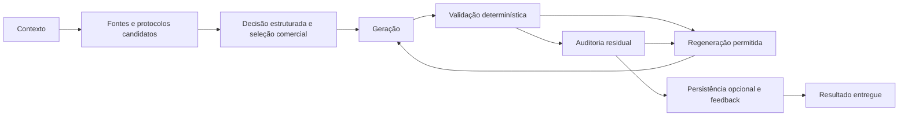

# Contrato offline de Qualidade/Evals da IA

Checkpoint: **IA-Q0-CONTRATO-LOCAL**. Versão documental: **1.0**, 16/10/2026, America/Sao_Paulo.

**Q0 define o contrato; não executa nem implementa Q1.** IA-M1c-F permanece HOLD. Nenhum resultado deste documento autoriza geração real, benchmark, mudança de prompt/modelo, banco, integração, deploy ou alteração de comportamento.

Leitura conjunta: [matriz de casos](../IA_Q0_MATRIZ_CASOS.md), [relatório Q0](../RELATORIO-IA-Q0-CONTRATO-LOCAL.md), [auditoria IA-00](../RELATORIO-IA-00-ESTADO-E-PROXIMA-FRENTE.md) e [política IA por ambiente](IA-AMBIENTES.md). A matriz é o catálogo de casos/slices; este arquivo define avaliação, dados, métricas e gates. Não há scorer, dataset executável ou runner novo.

## 1. Base, escopo e fronteiras

Referência de código: objeto Git local `0149ad44f4a3c1afa8b7e4cef8abaa8cfb5de883` (`origin/main`, obtido antes desta tarefa). Checkout documental: `codex/b3-2-auditoria`, HEAD `366dc0f1b8c7ec5794d880de6f038b0698e25598`. Não houve fetch, atualização da branch nem criação de worktree. O contrato não presume que a referência local seja a ponta remota hoje.

Prioridade: **F3/Atendimento ao proprietário**. Existem 25 cenários em `web/tests/fixtures/atendimento-semantico.ts`; sua identidade, expectativas existentes e lacunas estão na matriz. Os arquivos foram somente lidos. Evidências de outras frentes vêm da IA-00, sem repetir auditoria ou consultar banco.

| Fluxo | O que uma avaliação futura deve distinguir | Limite de Q0 |
| --- | --- | --- |
| F1 classificação | Desfecho/datas/motivos corretos, guardas de efeito e preservação da mensagem diante de falha | Somente fronteira conceitual; sem webhook ou alteração operacional |
| F2 transcrição | Fidelidade do texto, retry/degradação, áudio preservado, metadata por tentativa | Sem áudio real, download ou transporte; não é geração de resposta F3 |
| F3 atendimento | Contexto, fontes, decisão, candidato, guardas, auditor, regeneração, sugestão e feedback | Prioridade da matriz e do contrato offline |
| F10 Assistente | Entidade atual, referências, contexto tipado, ferramentas e confirmação de ações | Continuidade é referência para casos; sem executar ferramentas/ações reais |
| F13 embeddings | Contrato de lote/ordem/modelo/dimensão e falha; qualidade de recuperação é outro objeto | Sem implementação, vetorização ou edição de código compartilhado com Radar |

JEV = **PLANEJADO / FRENTE NOVA**, fora de Q0. Não integra dataset, scorer, provider, juiz ou arquitetura deste contrato.

São proibidos para escrita: PROJECT, schema, migrations, Radar/R6.1/BASE83, comparáveis, embeddings, finalização de coleta, harness/Docker do Radar e ANGARIO-DEV. O único documento preexistente atualizável nesta tarefa é a propagação pendente, por autorização expressa. Necessidade de outro arquivo compartilhado exige **HOLD daquela parte**, com dependência registrada. Não resolver overlap alterando silenciosamente produto ou configuração comum.

## 2. Unidade de avaliação e independência do oráculo

Um caso tem objetivo de produto, fontes sintéticas, expectativas e escopo congelados **antes da execução**. O oráculo é essa especificação revisada; não é o retorno atual do código, do modelo ou do auditor.

Escopos futuros:

- `candidate`: um candidato conhecido confrontado com fontes/expectativas; permite medir guardas. É o escopo dos 25 cenários catalogados. Bloquear uma candidata não significa que a solicitação inteira deva terminar sem regeneração.
- `stage`: uma etapa isolada, com entradas/saídas conhecidas; mede seleção, parser, decisão, validação ou persistência simulada.
- `request`: fluxo completo em memória, do contexto ao resultado, com modelo/persistência falsos; mede composição e orçamento, não capacidade de um modelo real.

Cada execução identifica caso, versão, escopo, repetição, tentativa da geração, etapa e SHA do sistema avaliado. Uma candidata regenerada não é nova execução de caso. Uma nova repetição é. O relatório apresenta ambas as unidades separadamente.

Expectativa de produto e expectativa técnica são distintas. Exemplo: “responder a condição comprovada e confirmar só a consequência desconhecida” vem antes de “código `omissao-parte-comprovada`”. Se o contrato técnico evoluir legitimamente, preservar o oráculo de produto e versionar o mapeamento; não alterar a expectativa para acomodar um erro.

Saídas declaradas pelo próprio modelo não são oráculo: `afirmacoes`, evidências, confiança, protocolos e obrigações também podem estar incorretos. Deve existir uma lista independente de fatos permitidos, proibidos e obrigatórios para comparar texto e declarações. Igualar `afirmacoes` ao texto sem verificar fontes não demonstra factualidade.

## 3. Etapas reais do F3

O desenho mostra caminhos possíveis, não execução obrigatória de todas as etapas. Bloqueios e erros podem terminar antes. Regeneração ocorre no máximo uma vez; ausência de feedback ativo pula a persistência de sugestão. Feedback humano é posterior à entrega/revisão, não condição retroativa de sucesso da geração.

| Etapa | Fronteira observada na base | O que o contrato futuro exige observar |
| --- | --- | --- |
| Contexto | `selecionarMensagensAtendimento`, contexto tipado do imóvel e leitura sob sessão/RLS | Entidade correta, autoria, ordem, mensagem atual, pendência, fontes ausentes e cortes; contexto completo no banco não significa prompt integral |
| Seleção de fontes/protocolos | Catálogo de fontes, comerciais ativos e conduta; seleção comercial final vem da decisão | Candidato ativo e suficiente, identidade sem ambiguidade, fonte inteira ou indisponibilidade explícita; arquivado/ausente não vira regra |
| Decisão estruturada | Schema/parser, evidências, lacunas, obrigações, social/factual e bloqueio de segurança | Decisão sustentada pela entrada; perguntas respondíveis não devem virar bloqueio global por lacuna secundária |
| Geração | Texto, protocolos, afirmações e obrigações cobertas | Resposta útil, sem fatos/ações inventados; texto e declarações dizem a mesma coisa |
| Validação determinística | Referências, grounding, escopo temporal, cobertura, perfil e limites | Rejeitar violações codificáveis e preservar positivos; distinguir detecção correta de defeito do próprio validador |
| Auditoria residual | Schema de `problemas` e julgamento residual texto/declarado, conduta e entidade | Não reabrir como fonte de verdade o que veio do modelo; detectar afirmação não declarada ou contradição no texto; não rejeitar resposta válida |
| Regeneração | Candidato novo a partir de motivo recuperável, sem reciclar a frase recusada | Uma regeneração, mesmas fontes autorizadas, mesmas guardas; nunca terceira geração/sexta chamada |
| Persistência/feedback | Sugestão antes da entrega quando ativa; feedback separado e idempotente | Falha de gravação não vira sucesso; flag desligada não consulta/escreve; feedback não envia mensagem nem ensina automaticamente |
| Resultado entregue | Rascunho editável ou erro/bloqueio seguro | Rascunho não é envio; não alegar atualização de Pipeline/Agenda; erro classificado sem dados privados |

Budgets caracterizados da base: até duas gerações/cinco chamadas lógicas; timeout de 45 s/chamada e retries SDK desativados no atendimento. Seleção de até 12 anteriores e quatro antigas relevantes além da atual; conteúdo e protocolos têm limites documentados na IA-00. Q0 não altera nenhum limite e não os usa como justificativa automática para perder uma pergunta válida.

## 4. Taxonomia de resultado, causa e detecção

Para evitar contagens contraditórias, um resultado futuro tem três campos distintos:

1. `quality_outcome`: exatamente um dos cinco resultados funcionais abaixo ou `NOT_APPLICABLE`.
2. `failure_categories`: zero ou mais causas observadas, com etapa de origem e etapa de detecção; quando houver várias, uma causa primária comprovada para distribuição sem dupla contagem. Se não há prova, causa primária é `null`, com estado “não atribuída”.
3. `contract_pass`: verdadeiro/falso para as expectativas do ensaio completo, inclusive resiliência e privacidade. Em teste de falha injetada, `PROVIDER_FAILURE` pode ser esperado e tratado corretamente: disponibilidade falhou na simulação, mas o contrato de resiliência passou.

Não inventar causalidade a partir de um HTTP. Um erro de geração detectado corretamente não torna o validador defeituoso. Uma resposta ruim liberada pelo auditor pode ter origem na geração e falha adicional no detector.

| Categoria | Significado operacional | Aplicação à etapa/resultado |
| --- | --- | --- |
| PASS_CORRETO | Candidato válido atende o objetivo integral; social também é integral quando só cortesia é necessária | `quality_outcome`; hard gates passam, obrigação relevante atendida |
| PASS_PARCIAL_ACEITAVEL | Parte relevante comprovada respondida; só a lacuna é qualificada/encaminhada | `quality_outcome`; não permite omitir fato necessário ou fingir confirmação |
| BLOCK_CORRETO | Candidato inadequado ou solicitação insegura é bloqueado corretamente no escopo avaliado | `quality_outcome`; bloqueio não é sucesso de texto nem disponibilidade |
| FALSE_ACCEPT | Candidato inadequado ultrapassa a fronteira de aceitação definida pelo caso | `quality_outcome`; explicitar se passou apenas pelo determinístico, auditor ou entrega final |
| FALSE_REJECT | Candidato adequado/solicitação respondível é recusado por julgamento ou regra incorretos | `quality_outcome`; falha de transporte não é rejeição semântica |
| CONTEXT_FAILURE | Identidade, mensagem atual, fonte pertinente, ordem/autoria ou conteúdo necessário se perdem antes da decisão | `failure_categories`; origem em contexto/seleção; não afirmar erro se ausência é real e corretamente tratada |
| DECISION_FAILURE | Intenção, social/factual, obrigações, fonte ou bloqueio estruturado contradizem o oráculo | `failure_categories`; decisão. Confiança baixa sozinha não prova falha |
| GENERATION_FAILURE | Texto/estrutura gerados omitem, inventam, contradizem ou não cumprem a decisão autorizada | `failure_categories`; geração inicial ou regeneração |
| DETERMINISTIC_VALIDATION_FAILURE | Guarda determinística aceita violação que deveria detectar ou rejeita positivo legítimo | `failure_categories`; validação. Reprovar candidato ruim corretamente não recebe esse rótulo |
| AUDITOR_FAILURE | Julgamento residual aprova texto inadequado ou rejeita texto adequado; saída estrutural inválida do auditor também é falha dessa etapa | `failure_categories`; auditoria. `problemas=[]` não prova ausência do defeito |
| PROVIDER_FAILURE | Timeout, rede ou erro de provider impede obter a resposta | `failure_categories`; transporte simulado. HTTP 200 com JSON inválido é falha estrutural da etapa, não automaticamente falha de transporte |
| PERSISTENCE_FAILURE | Sugestão/feedback/registro necessário não é gravado conforme contrato | `failure_categories`; persistência. Falha de log opcional não deve mudar o resultado funcional |
| NOT_APPLICABLE | Dimensão/etapa realmente não exercitada ou qualidade textual não julgável, com razão explícita | `quality_outcome` ou marcador de dimensão, nunca sinônimo de PASS ou dado faltante |

Defeitos de interface de entrega/autorização sem categoria causal acima podem usar causa primária não atribuída e `contract_pass=false`, registrando a expectativa violada e etapa. Não forçar tudo em `GENERATION_FAILURE`. Novas categorias só entram por revisão de contrato com exemplo real de necessidade.

Falha estrutural é um atributo transversal (`structural_failure`, etapa): esquema/JSON inválido, campo extra/ausente ou vazio fora do contrato. Um defeito do parser só recebe categoria de validação quando houver prova de que o parser aceitou/rejeitou incorretamente; uma resposta de modelo fora do schema é falha da etapa que a produziu.

“Falha de modelo” é uma atribuição de origem, não um rótulo que substitui a etapa: com entrada/contexto válidos e oráculo independente, uma saída inadequada de decisão, geração ou auditoria pode ter origem na saída do modelo. Contexto errado, parser defeituoso, transporte indisponível e persistência recusada não devem ser atribuídos ao modelo por exclusão. No replay, essa origem é apenas **simulada por fixture**; não há evidência de falha de um modelo real nem acesso ao seu raciocínio. Sem trace suficiente, manter causa não atribuída.

## 5. Qualidade, segurança e operação são eixos separados

| Eixo | Pergunta | Não usar como substituto |
| --- | --- | --- |
| Qualidade funcional | Respondeu a necessidade com fatos permitidos e utilidade? | HTTP 200, usage, metadata ou lista vazia de problemas |
| Telemetria | Uso observado, eventos e correlação representam fielmente o que ocorreu? | Presença de linha não prova que o texto foi usado |
| Disponibilidade | Etapas necessárias responderam e a sugestão pôde ser entregue? | Bloqueio correto não equivale a serviço disponível para resposta |
| Segurança | Entidade/tenant, autonomia e hard gates permaneceram preservados? | Bom texto/tom não autoriza efeito externo |
| Privacidade | Entradas, logs e artefatos respeitam a fonte autorizada? | Conteúdo sintético não autoriza importar feedback real |

É possível ter texto correto com metadata faltante: qualidade pode passar e telemetria falhar. É possível ter bloqueio seguro diante de timeout: qualidade textual é não aplicável e resiliência pode passar. É possível ter HTTP 200, usage e `problemas=[]` com informação inventada: `FALSE_ACCEPT`.

F3 conserva seus diagnósticos próprios de etapa/validação; não se deve inferir sua taxa de rejeição apenas de `ia-resposta-rejeitada`. Feedback humano, rejeição pelo código e falha de provider permanecem medidas diferentes.

## 6. Scoring proposto — não implementado

Hard gates são condições binárias aplicáveis ao caso; ausência de evidência para julgá-los é **não julgado**, não aprovação. Nenhum soft score compensa hard gate reprovado.

| Dimensão | Hard gate | Parcela graduável |
| --- | --- | --- |
| Grounding | Cada afirmação factual/temporal tem fonte autorizada que sustenta o escopo, independentemente da declaração do modelo | Nenhuma compensação |
| Factualidade | Texto não contradiz fatos/valores do oráculo nem converte hipótese em fato | Nenhuma compensação |
| Cobertura | Toda parte comprovada obrigatória relevante é comunicada; obrigações alegadas correspondem ao texto | Cobertura opcional sem desvio ou redundância |
| Temporalidade | Atual, histórico, atemporal, antes/depois de evento não são trocados sem fonte | Clareza da qualificação, dentro da conformidade de redação |
| Entidade | Identidade e vínculo da informação pertencem à entidade/conta esperadas; continuidade não faz troca silenciosa | Nenhuma compensação |
| Protocolo | Item ativo, aplicável, não inventado/ambíguo; título/ID e suporte correto | Nenhuma compensação |
| Segurança | Sem efeito não autorizado, insistência proibida, vazamento ou contorno de regras | Nenhuma compensação |
| Conformidade | Estrutura/schema, limites explícitos e restrições de conduta cumpridos | Clareza, concisão e ausência de reapresentação desnecessária |
| Utilidade | Não substitui hard gates de cobertura ou segurança | Próximo passo útil, proporcional e focado na necessidade |
| Tom/perfil | Restrição explícita obrigatória, como emoji desativado/limite de tamanho, respeitada | Naturalidade e adequação às preferências sintéticas |

Escala soft: **0** inadequado, **1** utilizável com edição localizada, **2** adequado sem edição relevante; `NOT_APPLICABLE` exige justificativa congelada antes da execução. Dado ausente de avaliação fica não julgado e não sai silenciosamente do denominador.

Índice soft proposto: `100 × soma(peso × nota) / (2 × soma dos pesos aplicáveis)`. Pesos: utilidade 40, tom/perfil 30, cobertura opcional 20, conformidade de redação 10. Peso de dimensão não aplicável é retirado com motivo; todos não aplicáveis produzem índice não aplicável. Sempre mostrar notas, pesos e número de dimensões julgadas junto do índice.

Aceitação de um texto: hard gates aplicáveis aprovados, utilidade 2, índice soft pelo menos 75 e nenhuma nota soft 0. Aprovação parcial exige adicionalmente lacuna explícita e parte conhecida relevante respondida. Os limiares são proposta normativa de Q0 para o futuro ensaio, não calibragem estatística nem mudança no validador do produto. Devem ser congelados antes do lote futuro, sem ajuste posterior para fazê-lo passar.

Para candidato propositalmente inadequado, o ensaio passa ao detectar a violação esperada; não atribuir nota de qualidade alta ao texto bloqueado. Para falha de provider/sem texto, notas textuais são não aplicáveis e mede-se resiliência. Verificar primeiro gate e escopo, depois score; protocolo inventado nunca é compensado por bom tom.

## 7. Métricas e denominadores

Publicar contagens e denominadores, por fluxo/escopo/versão, além de percentuais. Denominador zero = não aplicável; nunca 0% ou 100%. Casos não executados, inválidos, não julgados e falhas operacionais devem aparecer separadamente para não melhorar artificialmente a taxa.

Notação: `N_planejados`, `N_executados`, `N_validos` (fixture e execução do ensaio válidos); `N_julgados` (desfecho funcional completo e oráculo aplicável); `N_allow` e `N_block` são os julgados cuja expectativa independente permite ou proíbe aceitação. Falha operacional antes de julgar candidato não é falsa rejeição e não entra nesses dois últimos; continua em disponibilidade e pass rate contratual.

| Métrica | Definição proposta | Observação |
| --- | --- | --- |
| Pass rate funcional | `(PASS_CORRETO + PASS_PARCIAL_ACEITAVEL + BLOCK_CORRETO) / N_julgados` | Bloqueios esperados contam como contrato correto; mostrar separadamente taxa de respostas úteis |
| Pass rate contratual | Execuções com `contract_pass=true / N_validos` | Inclui casos de resiliência; não confundir com qualidade textual |
| False accept rate | `FALSE_ACCEPT / N_block` | Fronteira de aceitação explicitada; candidata e solicitação têm relatórios separados |
| False reject rate | `FALSE_REJECT / N_allow` | Não inclui timeout, falha de persistência ou caso não julgado |
| Block rate | Desfechos funcionais bloqueados / `N_julgados` | Separar bloqueio correto e falso, por expectativa |
| Resposta útil entregue | Solicitações com resposta integral/parcial aceita / solicitações válidas que deveriam entregar rascunho | Falha operacional reduz esta taxa, mesmo fora da FAR/FRR |
| Erro por etapa | Execuções com causa primária comprovada na etapa / execuções válidas que alcançaram a etapa | Mostrar também causas secundárias; não somá-las como execuções distintas |
| Erro por slice | Execuções julgadas que violam expectativa do slice / julgadas daquele slice | Slices multirrótulo se sobrepõem; não somar seus totais |
| Regeneração | Solicitações que iniciam segunda geração / solicitações válidas que iniciam primeira geração | Separar motivo; bloqueio antes de gerar fica fora |
| Recuperação após regeneração | Segunda candidata entregue e correta / solicitações que iniciaram segunda geração | Falha na segunda tentativa permanece no denominador; não ocultar por ausência de texto |
| Falha estrutural | Saídas fora do schema / saídas recebidas na etapa em que o schema é exigido | Também informar contagem sobre tentativas lógicas totais; transporte sem resposta não é JSON inválido |
| Provider failure | Tentativas de transporte com exceção/HTTP de erro / tentativas lógicas ao provider | No replay são tentativas falsas, rotuladas como simulação; em F2/F10/F13 preservar unidade tentativa/lote/rodada |
| Falha de persistência | Operações de sugestão/feedback recusadas / operações necessárias tentadas | Telemetria opcional separada de persistência de negócio |
| Cobertura de casos | IDs distintos exercitados / IDs aprovados para o lote | E/P apenas catalogados não contam como exercitados |
| Cobertura de slices | Slices com ao menos um caso exercitado / slices previstos para o escopo | Informar positivos/negativos faltantes, etapas atingidas e quantos têm oráculo revisado |
| Hard gate leakage | Candidatas com violação obrigatória liberadas / candidatas adversariais aplicáveis | Meta de aceitação do lote: nenhuma violação crítica liberada; sem promessa de taxa populacional |

Futuro modelo real: congelar número de repetições por caso/configuração antes do lote; no mínimo cinco para uma primeira descrição exploratória, com limite de custo definido por humano. Registrar distribuição de outcomes, proporção de pass por caso, casos que alternam pass/fail entre repetições, dispersão do score e latência, contagens por categoria e seeds quando suportadas. Não escolher a melhor repetição nem descartar recusas. Cinco repetições não garantem poder estatístico; inferência comparativa ou lançamento exige plano amostral próprio. Nada disso é executado/autorizado por Q0.

## 8. Dataset futuro versionado

Formato conceitual sugerido: registros JSON, com schema de dataset próprio e independente dos payloads de produto. Q0 não cria os arquivos JSON nem implementa schema/adaptadores. Campos em português para dados sintéticos e as chaves conceituais abaixo; texto de fixture pode usar chaves já existentes do contrato de produto, sem modificar sua forma.

| Campo | Conteúdo e regra |
| --- | --- |
| `id` | Estável e único; IDs E/P da matriz são referências do catálogo, não IDs reais de imóvel |
| `descricao` | Objetivo de produto, sem transcrição de conversa privada |
| `flow`, `evaluation_scope` | F3 prioritário; candidate/stage/request explícito |
| `slice` | Lista de IDs do catálogo S01–S27; um primário opcional para agregação não sobreposta |
| `entrada_sintetica` | Mensagem/solicitação inventada, autoria e ordem quando pertinentes |
| `contexto_sintetico` | Entidades fictícias, fatos atuais/históricos, ausências e instante operacional fixo |
| `protocolos_sinteticos` | IDs/títulos fictícios, categoria, conteúdo, ativo/arquivado e temporalidade; não copiar regras reais da empresa |
| `decision_fixture` | Objeto conhecido ou referência local sintética compatível com schema da base; opcional se etapa não for exercitada |
| `generation_fixture` | Texto e declarações conhecidos; lista ordenada por tentativa quando houver regeneração |
| `auditor_fixture` | Saídas conhecidas do auditor, por tentativa; não pode fornecer o próprio oráculo |
| `operational_fixtures` | Sequência de sucesso/erro de transporte, persistência e metadata, explicitamente falsos |
| `expected_outcome` | Expectativa de produto/qualidade para a fronteira avaliada, fixada antes; não apenas código atual |
| `hard_expectations` | Fatos permitidos/proibidos/obrigatórios, entidade, protocolo, escopo temporal, limites de efeitos e privacidade; fonte de verdade independente |
| `soft_expectations` | Âncoras de utilidade/perfil, notas/limiar aplicáveis e motivos de não aplicabilidade |
| `expected_trace` | Etapas alcançadas/vedadas, chamadas máximas, fallback, gravações permitidas e outcome de resiliência |
| `privacy_classification` | Uma das quatro classes da seção 9, com somente duas permitidas em Q0 |
| `source` | Origem sintética/padrão genérico, versão/commit do caso catalogado e referência documental; sem ID de usuário/conversa real |
| `notes` | Lacunas, prioridade, revisão de oráculo e causa ainda não atribuída; sem conteúdo privado |
| `dataset_version`, `oracle_version` | Versões explícitas; hash e manifesto do lote futuro permitem repetição |

Validações futuras de dataset: IDs e referências únicos/consistentes; pelo menos um slice conhecido; ausência não preenchida artificialmente; timestamps sintéticos estáveis; hard expectations não derivadas automaticamente da saída; etapas não aplicáveis justificadas; fixtures positivas/negativas distinguidas; escopo explícito; origem permitida. `null` de etapa não exercitada difere de campo obrigatório ausente e de saída JSON `null` adversarial.

Revisão antes de adaptar os 25 casos: preservar nome/código histórico como rastreabilidade, criar oráculo de produto independente, verificar compatibilidade dos objetos herdados com etapa efetiva. O caso social existente herda campos da decisão factual e não comprova o decisor social; não “corrigir” a fixture existente em Q0. O catálogo negativo de protocolo inadequado pode conter omissão simultânea: preservar o objetivo e explicitar a precedência técnica.

Um caso inválido para o schema do ensaio não pode ser contado como rejeição semântica bem-sucedida. A adaptação futura deve falhar como problema de dataset e não alterar silenciosamente expectativas ou objetos existentes.

## 9. Contrato de privacidade

| Classe | Definição | Uso em Q0 |
| --- | --- | --- |
| SYNTHETIC | Criado integralmente para o ensaio, sem pessoa, conta ou conversa reais | Permitido como especificação documental |
| GENERIC_HISTORICAL_PATTERN | Padrão abstrato de falha histórica, sem reprodução de mensagens ou identificadores pessoais | Permitido; labels históricos existentes servem só para rastreabilidade documental |
| HUMAN_REVIEWED_ANONYMIZED | Conteúdo com revisão humana e comprovação de remoção de dados identificáveis | Não incluído em Q0; exigiria autorização/revisão próprias |
| PRODUCTION_FORBIDDEN | Conteúdo de Production, export bruto, feedback/conversa real não autorizado ou com anonimização insuficiente | Proibido no dataset e nos artefatos |

Não incluir telefone, nome real, canal WhatsApp real, mensagem privada, endereço/coordenada real, e-mail, documento pessoal, user_id, hash C1, ID real de mensagem/contato/imóvel ou credencial. Também evitar identificação indireta por combinação de atributos. Labels LD históricos citados no inventário não autorizam lookup, export ou reprodução. Entidades futuras usam identificadores locais fictícios, como `imovel-A`, nunca mapeados a registros reais.

Não ler `.env.local`, export de feedback, logs privados ou arquivo de secrets para montar fixtures. Feedback aprovado/editado/rejeitado não entra automaticamente no dataset, memória ou aprendizado. Obter revisão humana/anonimização não faz parte desta tarefa.

Casos de logging usam sentinelas claramente artificiais, por exemplo `CONTEUDO_PRIVADO_SINTETICO`, sem chave/token com aparência de credencial válida. O futuro capturador compara presença/ausência da sentinela em memória; relatório registra só código de violação e etapa, sem repetir o payload. Oráculos e textos sintéticos podem ser versionados; saídas de provider real futuro exigem política própria antes de retenção.

Metadados admitidos no relatório offline: caso/slice/etapa, IDs sintéticos, outcome, contagens e tempos locais, versão/hash de artefato e código de falha. Um log de diagnóstico completo do modelo nunca é necessário para declarar PASS.

## 10. Replay offline versus eval real

| Aspecto | Replay offline futuro | Eval real de modelo futuro |
| --- | --- | --- |
| Entrada da etapa probabilística | Saídas sintéticas conhecidas e injetadas | Saída produzida pelo modelo |
| O que mede | Contratos, seleção, parser, guardas, fluxo, orçamento e resiliência | Comportamento probabilístico, qualidade/variância do modelo na tarefa |
| Auditor residual | Resposta conhecida de auditor falso; mede reação, não julgamento real | Julgamento real, confrontado com oráculo independente e revisão prevista |
| Rede/credencial | Proibidas; qualquer tentativa deve falhar no harness | Dependem de autorização humana, ambiente permitido e limites próprios |
| Persistência | Adaptador em memória e captura de operações | Integração real só em escopo específico; nunca implícita |
| Resultado | “Contrato offline passou/falhou” | Resultado exploratório/comparativo limitado à amostra, nunca equivalente a rollout |
| Autorização atual | Apenas especificado, não implementado nem executado | Não autorizado; Codex/CI continuam proibidos de OpenAI real |

Procedimento proposto para implementação futura, após o gate humano:

1. Fixar base do código, versão do dataset, escopo, expectativas e fontes permitidas; conferir manifesto Radar.
2. Construir harness em namespace próprio com transporte, armazenamento, relógio e gerador de IDs falsos. Bloquear qualquer egress, inclusive SDK, download de mídia e chamadas de telemetria.
3. Impedir import com efeitos de servidor sem substituição explícita. `registro.ts` pode gravar após resposta; mocká-lo antes de carregar handler. Não depender da ausência de chave para garantir offline.
4. Reproduzir entradas e saídas conhecidas na ordem de etapas/tentativas; consumos extras/fixtures não consumidas indevidamente falham. Não avaliar código com cópia reimplementada do próprio validador.
5. Confrontar contexto/decisão/candidatas/resultado com o oráculo independente. Capturar apenas trace sintético; distinguir defeito da candidata, falha do detector e falha do harness.
6. Registrar resultado por etapa/caso/slice e denominadores. Manter asserções positivas e negativas, inclusive rejeição indevida e preservação de resposta parcial segura.
7. Repetir exatamente a mesma entrada no replay para detectar não determinismo local inesperado. Isso não é repetição de modelo nem estima sua variância.

Não reutilizar o runner `web/tests-real-openai/` como runner offline. Não adicionar opt-in que libere rede ao harness. Q0 não publica comando de execução porque nenhum runner foi criado. Toda futura suíte paga continua exclusiva de humano, fora de Codex/CI e proibida em Preview conforme IA-AMBIENTES.

## 11. Cenário sintético longo inspirado na lacuna LD-156

Esta é **especificação nova**, não reconstituição do incidente. Não consultar conversa real nem atribuir causa histórica. Casos propostos P017–P021 da matriz compartilham a base abaixo e variam uma condição por vez.

Base sintética fixa:

- Duas entidades fictícias, `imovel-A` (selecionada) e `imovel-B` (distratora); nenhuma contém endereço, nome, telefone ou vínculo real. Fatos de cada uma são distintos para identificar troca.
- Cem notas sintéticas em ordem fixa: 80 mensagens textuais de contexto genérico alternando autores, dez marcadores de mídia e dez entradas vazias. Os últimos itens do histórico antigo incluem um fato relevante de A e um fato conflitante antigo, explicitamente superado por dado atual.
- Depois dessas cem notas, uma saída do corretor e uma entrada textual atual inequívoca do proprietário: pergunta sobre condição comercial coberta por protocolo ativo e fato atual de A. A pergunta não depende de adivinhar entidade nem de fonte incompleta.
- Ao menos uma mensagem antiga relevante está fora da janela recente e deve ser recuperável pelo objetivo do caso; demais antigas são irrelevantes. Registrar no oráculo a informação necessária, não exigir texto integral de todo o histórico.
- Protocolos sintéticos suficientes e dentro dos limites; categoria/temporalidade explícitas. Perfil sintético simples, sem restrição contraditória. A variante de bloqueio introduz uma afirmação depois do evento sustentada apenas por regra anterior ao evento.
- Autoria, IDs sintéticos e tempos fixos; empate intencional deve ter resultado determinístico. Mídia/vazios não apagam uma entrada textual pendente. Nenhuma mensagem posterior é acrescentada implicitamente: cada variante declara sua ordem.

| Variante | Diferença controlada | Expectativa de produto | Classificação que o futuro ensaio deve distinguir |
| --- | --- | --- | --- |
| P017 | Acrescentar uma saída textual posterior do corretor, respondendo à última entrada | Nenhuma pendência atual; não gerar nova resposta nem declarar histórico perdido | BLOCK_CORRETO no escopo de sugestão pendente; decisão/generation não exercitadas |
| P018 | Base com entrada pendente; ensaio adversarial remove a mensagem atual da seleção, preservando a entrada fonte | A mensagem deveria estar disponível; perda deve ser detectada | CONTEXT_FAILURE; desfecho não deve ser contado como bloqueio correto, mesmo que o sistema devolva erro seguro |
| P019 | Contexto íntegro e suficiente; saída decisória conhecida bloqueia indevidamente por baixa confiança | Era possível resposta integral/limitada segura | FALSE_REJECT + DECISION_FAILURE; não imputar ao seletor |
| P020 | Contexto/decisão válidos; geração devolve estrutura inválida/vazia | Não entregar candidato inválido; erro operacional seguro e sem terceira tentativa indevida | GENERATION_FAILURE com `structural_failure`; qualidade textual não aplicável e resiliência julgada separadamente |
| P021 | Candidata altera escopo temporal/entidade/fato, contrariando fontes | Bloquear candidata ruim antes de entregar; registrar motivo | BLOCK_CORRETO + defeito da candidata (GENERATION_FAILURE); não DETERMINISTIC_VALIDATION_FAILURE quando a guarda agiu corretamente |

Controle positivo da família: a mesma base com seleção/decisão/geração válidas deve produzir resposta útil e permitir a revisão. Ele é pré-condição de sensibilidade das variantes e será desdobrado no futuro dataset, sem executar agora. Preservar esse controle impede “resolver” a família bloqueando todas as conversas longas.

P018/P019 são injeções documentadas de defeito: a expectativa de produto continua permitir resposta. O futuro ensaio pode aprovar a **detecção do defeito**; isso não transforma o fluxo defeituoso em PASS funcional. Capturar `detection_pass` apenas para experiência adversarial, mantendo `contract_pass=false` do comportamento sob defeito.

## 12. Resiliência e falhas offline

Casos de provider e estrutura têm expectativa operacional além da textual; estão em P022–P028. Não gerar falhas reais para preencher cobertura.

| Evento falso | O que preservar | Classificação e limite |
| --- | --- | --- |
| Timeout/conexão/HTTP de erro | Erro seguro, sem sugestão fantasma, sem duplicação/retry não previsto | PROVIDER_FAILURE; texto não aplicável; simular tipos/status sem copiar mensagem de erro real |
| Structured Output inválido | Parser estrito e distinção 5xx versus bloqueio de domínio | Falha estrutural na etapa produtora, não HTTP 200 de qualidade |
| Resposta vazia | Não usar como resposta nem como aprovação; manter limite do fluxo | Falha estrutural/geração; transporte só falhou se houver evidência própria |
| Metadata ausente | Resultado funcional legítimo não é alterado só para criar metadata; contrato de telemetria acusa lacuna | Qualidade e telemetria avaliadas separadamente; ausência não prova chamada não ocorrida |
| Segunda geração falha | Usos já observados preservados, erro original classificado, sem terceira geração | PROVIDER_FAILURE ou GENERATION_FAILURE segundo o evento; recuperação falhou |
| Usage parcial/ausente | Não inventar zero de consumo nem completar modelo/request ID | Partes conhecidas mantidas; custo/telemetria desconhecidos explicitados; texto pode continuar correto |
| Persistência de sugestão falha | Quando ativa, não entregar sucesso com sugestão perdida | PERSISTENCE_FAILURE; sem sucesso fictício e sem efeito externo |
| Log opcional falha | Resposta funcional preservada, diagnóstico seguro do defeito de observabilidade | PERSISTENCE_FAILURE do registro opcional; não simular como falha do provider |

## 13. Mutantes semânticos futuros — sem execução em Q0

Mutantes modificam somente fixture/saída sintética em memória no futuro harness, não arquivos de produto compartilhados. Um mutante morto precisa acionar uma expectativa de produto específica; erro de import, schema do dataset inválido ou indisponibilidade do harness não conta como detecção útil.

| ID | Mutação de fixture | Sinal esperado |
| --- | --- | --- |
| M01 | Trocar entidade A por B mantendo texto plausível | Gate de entidade; FALSE_ACCEPT se liberado |
| M02 | Declarar protocolo inexistente/arquivado como ativo | Gate de protocolo/fonte |
| M03 | Remover fato obrigatório da resposta e da lista de cobertura | Omissão detectada pelo oráculo, mesmo que a declaração do modelo pareça consistente |
| M04 | Trocar antes por depois de evento sem fonte nova | Gate temporal |
| M05 | Acrescentar taxa/multa inexistente em texto e declaração | Factualidade/grounding; tom não compensa |
| M06 | Acrescentar fato sem fonte válida | Grounding |
| M07 | Transformar confirmação de lacuna em certeza integral | Factualidade/temporalidade; preservar positivo parcial de controle |
| M08 | Retirar mensagem atual da seleção com fonte original intacta | CONTEXT_FAILURE, não simples “sem histórico” legítimo |
| M09 | Inserir histórico conflitante e fazê-lo prevalecer sobre dado atual | Prioridade atual versus histórico |
| M10 | Declarar obrigação coberta sem comunicá-la no texto | Auditor residual/oráculo detecta inconsistência |
| M11 | Trocar auditor negativo por `problemas=[]` diante de afirmação não declarada | AUDITOR_FAILURE + FALSE_ACCEPT; resposta vazia de problemas não é oráculo |
| M12 | Inserir reprovação residual sem fundamento contra candidata válida | AUDITOR_FAILURE + FALSE_REJECT |

Cada mutante futuro exige controle sem mutação aprovado e demonstração de falha da expectativa certa com a mutação. Registrar taxa de mutantes detectados apenas entre mutantes válidos executados, mais inválidos/não exercitados. Não usar número de mutantes como taxa de erro populacional de modelo.

## 14. Dependência para abrir Q1 real

Q0 pode receber PASS documental enquanto M1c-F continua HOLD. Q1 permanece **NÃO INICIADO**, inclusive implementação do harness/dataset/scorer; a autorização atual termina nos documentos.

Pré-condições cumulativas para uma decisão futura:

1. Duas semanas completas de segunda a domingo UTC na janela válida. Primeiro limite temporal: **19/10/2026 00:00 UTC = 18/10/2026 21:00 America/Sao_Paulo**. Data necessária, não suficiente.
2. Pelo menos **200 chamadas F1 instrumentadas no mesmo cohort C1**, usando o identificador completo original e as definições do baseline. C1/volume não apurados aqui; não inferir conta nem registrar hash público.
3. Metadados e cobertura conferidos pelos marcos de cada fluxo, com bloqueadores tratados; ausência de amostra natural isolada segue a regra vigente do baseline, sem inventar tráfego para produzi-la.
4. Fechamento **formal e documentado de IA-M1c-F**, por quem estiver autorizado a apurar evidências; Q0 não substitui essa apuração.
5. Decisão humana explícita sobre escopo de Q1, dataset/oráculo, orçamento e ambiente se houver modelo real. Aprovação de Q1 não revoga a proibição de Codex/CI chamarem OpenAI.
6. Overlap Radar resolvido para o manifesto concreto e base de implementação reconciliada. Sem alteração de fontes comuns/infra para “só facilitar” Evals.

Depois desses gates, o primeiro passo sugerido continua sendo harness offline isolado e validação de dados sintéticos. Eval real é outra autorização operacional, nunca fallback automático do replay. Preview permanece bloqueada para IA real. Não consultar Production/banco agora.

## 15. Aceitação documental de Q0

Q0 recebe PASS apenas se contrato/matriz/relatório existirem, 25 casos estiverem identificados sem alteração de fonte, 27 slices estiverem definidos, taxonomia/scoring/métricas/dataset/replay/privacidade estiverem especificados, família longa e mutantes forem documentais, gates estiverem preservados e verificações documentais passarem.

Validar links, unicidade/referências de IDs e slices, contagens e nomes da matriz, ausência de PII/secrets evidentes ou dados copiados de Production, `git diff --check` incluindo arquivos novos, e manifesto de alteração restrito aos documentos. Não executar suítes de produto, runner pago, mutantes, banco ou smoke real para aprovar documentação.

Limites conhecidos: 25 candidatas não cobrem por si só decisão, seleção, persistência ou julgamento real do auditor; presets, respostas HTTP e testes históricos não demonstram qualidade atual de modelo. Lista de arquivos não commitados na outra máquina não foi disponibilizada; não afirmar ausência global de concorrência. Nenhum gate pendente é convertido em PASS de produto.

**STOP: Q0 documental. Q1 não autorizado nem iniciado.**
