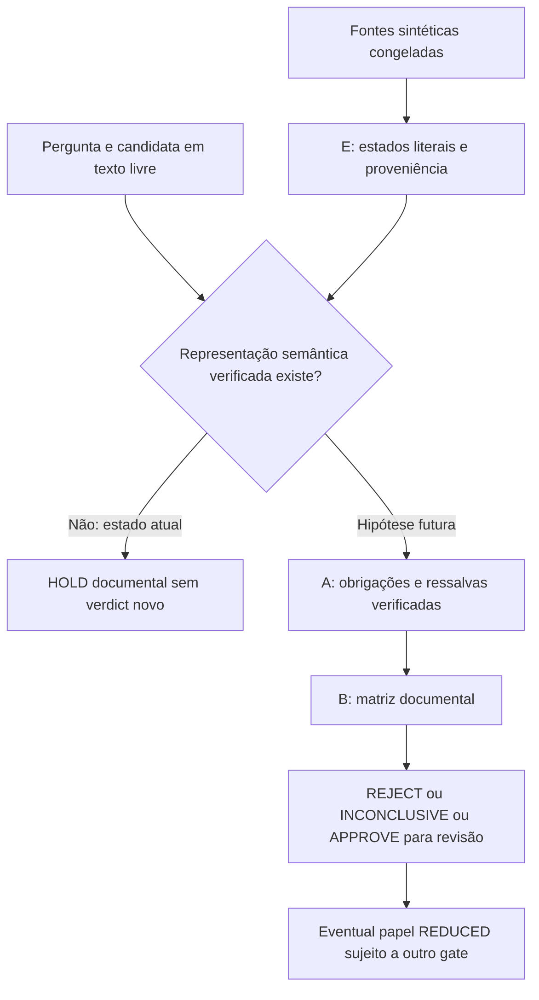

# ADR-G2-C-B0 — proposta híbrida A+B+E

**Status:** Proposta; INCONCLUSIVO. **Data:** 2026-10-17 (data local). **Decisão:** nenhuma arquitetura adotada. **Decisores:** revisão humana do gate.

## Contexto

G2-B conserva dois braços negativos e comparação inconclusiva. G2-C-A localizou inconsistência de agregação e erro dimensional emGG29, calibração inconclusiva inadequada e superfície FULL adicional; mecanismo interno indeterminado. É necessário verificar se um desenho evita deslocar inferência semântica para uma camada chamada determinística.

## Proposta sujeita a comprovação

Separar evidência literal E, representação semântica verificável e obrigações A, matriz B e eventual julgamento REDUCED, com HOLD/STOP explícitos. Representação semântica é dependência em aberto, não componente implementado.

## Alternativas e trade-offs

| Alternativa | Benefício conceitual | Custo/risco | Estado |
| --- | --- | --- | --- |
| Somente campos atuais | Não inventa observabilidade | Não decide cobertura semântica; adia todos os casos se exigido como caminho obrigatório | Insuficiente para resolverGG29 automaticamente |
| Revisão humana estruturada | Produz vínculos explícitos auditáveis | Custo humano, escala e consistência não medidos; não é autonomia determinística | Possível origem futura, não disponível como input histórico |
| Representação confiável com renderização controlada | Texto poderia preservar propriedades de um plano verificado | Muda geração/contrato do produto e limita linguagem; certificado não pode vir do mesmo modelo sem verificação | Somente hipótese; não implementar aqui |
| Extrator semântico por modelo | Pode interpretar linguagem livre | Desloca a falha e acrescenta custo/provider; não é precheck determinístico independente | Não resolve a premissa doB0 sem comprovação |
| Regex/fraseGG29 ou estado global | Barato no exemplo | False block de parciais, false allow por equivalência/escopo, dependência do caso | Rejeitada |
| F: não prosseguir com JEV Guard | Evita gasto/integração sem ganho semântico demonstrado | Pode abandonar utilidade futura ainda não comprovada | Mais defensável para nenhuma ação operacional agora |

## Consequências

Os estados explícitos melhoram auditabilidade conceitual, mas não fecham o vínculo texto↔evidência. Um HOLD conservador de todas as positivas não é solução útil. O desenho não justifica experimento pago agora. F e revisão humana continuam alternativas. Não há evidência de necessidade das11 dimensões obrigatórias.

## Ações propostas — não iniciadas

- Revisão humana dos artefatos e opçãoF.
- Se autorizado em outro escopo, investigar fonte verificável da representação semântica e avaliar extração sem oracle em entradas independentes.
- Somente depois discutir qualquer contrato/prompt/experimento novo com autorização própria.
